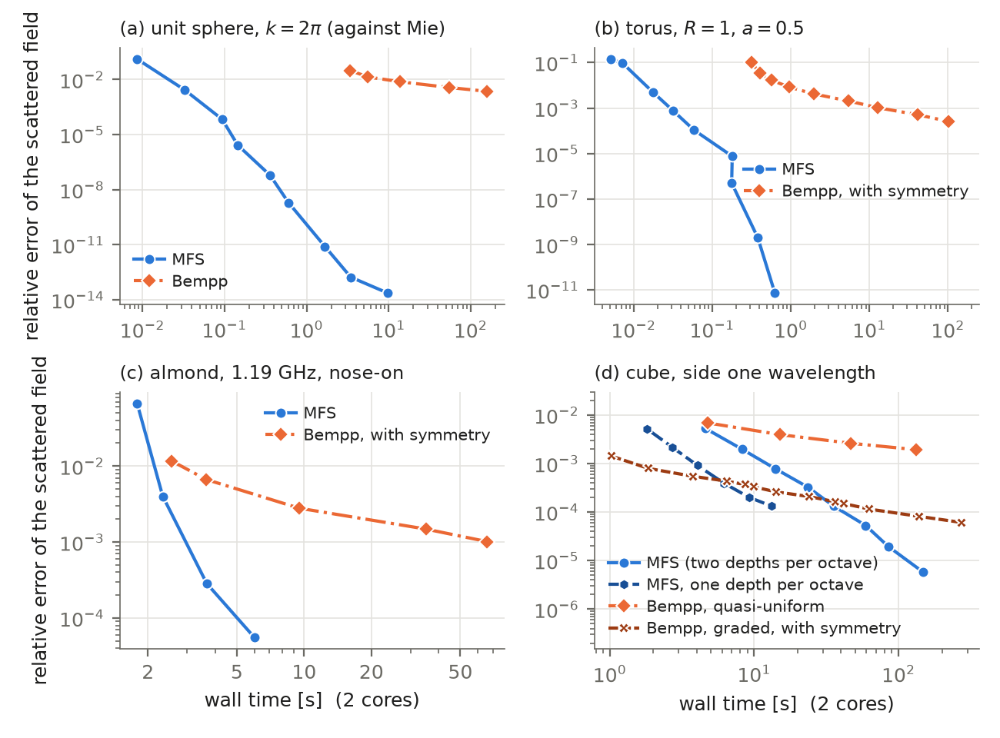

# The Method of Fundamental Solutions for Maxwell's Equations

[](https://github.com/sap6/MFS/actions/workflows/tests.yml)
[](https://colab.research.google.com/github/sap6/MFS/blob/main/notebooks/1_sphere.ipynb)
[](LICENSE)

Code and data for the paper *The Method of Fundamental Solutions for Maxwell's
Equations* by Saptarshi Bandyopadhyay and Timo Betcke (submitted to the
Journal of Computational Physics). The paper grew out of the first author's
MSci thesis, whose notebooks are kept in [`thesis/`](thesis).

The Method of Fundamental Solutions (MFS) approximates the field scattered by a
perfect conductor by a sum of dipoles placed inside the body. It needs no mesh
and no integration over the surface, and it converges rapidly, but only if the
sources are in the right place. We study where to place them on four shapes: a
sphere, a torus, a cube and the NASA almond. For the cube, the usual layout (a
smaller copy of the surface) stalls at errors above 20%. In contrast, sources on
the planes that bisect the edges, continued by *singular tails*, converge
root-exponentially.



*Error of the scattered field against computing time for the MFS and for the
boundary element library Bempp, both using the same symmetries of the body
(Figure 10 of the paper).*

## Try it in the browser

Each notebook runs in a few minutes on Colab, with no installation. Click the
badge at the top of each notebook, or below.

| Notebook | What it shows | Time |
|---|---|---|
| [1. The sphere](notebooks/1_sphere.ipynb) [](https://colab.research.google.com/github/sap6/MFS/blob/main/notebooks/1_sphere.ipynb) | one solve against the Mie series, convergence like exp(-c√N), the field near the surface | under a minute |
| [2. The torus](notebooks/2_torus.ipynb) [](https://colab.research.google.com/github/sap6/MFS/blob/main/notebooks/2_torus.ipynb) | mode-by-mode solve, the optical theorem, how thin the source torus may be | under a minute |
| [3. The cube](notebooks/3_cube.ipynb) [](https://colab.research.google.com/github/sap6/MFS/blob/main/notebooks/3_cube.ipynb) | why the usual layout stalls, sources on the skeleton, the singular tails, any incident wave | about four minutes |
| [4. The NASA almond](notebooks/4_almond.ipynb) [](https://colab.research.google.com/github/sap6/MFS/blob/main/notebooks/4_almond.ipynb) | sources on the mid-plane, the tip tail, radar cross-section against the Austin benchmark | about two minutes |

## Install

    pip install git+https://github.com/sap6/MFS

or, to run the figure scripts and the tests as well:

    git clone https://github.com/sap6/MFS && cd MFS
    pip install -e ".[test]"          # add ",bempp" for the boundary element comparison
    python -m pytest tests            # about a minute, most of it compiling the kernels

Then, for example, the sphere against the Mie series:

```python
import numpy as np
from mfs import core, mie, sphere

k = 2 * np.pi                                   # the sphere is two wavelengths across
d, p = core.wave()                              # the plane wave: along -z, polarised along y
y, alpha = sphere.solve(400, k, R=0.5)          # 400 dipoles on the sphere of radius 0.5
pts = 2.0 * core.fibonacci(400)
print(f"{core.rel(core.field(pts, y, alpha, k), mie.scattered_field(pts, k, d, p)):.1e}")   # 2.0e-09
```

Each shape has one entry point:

| Shape | Call | Returns |
|---|---|---|
| sphere | `sphere.solve(N, k, R)` | source points and coefficients; the field is `core.field(pts, y, alpha, k)` |
| torus | `torus.scatter(k, d, p, ns, nphi)` | a solution with `.field(pts)` and `.far(dirs)` |
| cube | `cube.solve(J, d, p, pts)` | the field at `pts`, the time, and checks (unknowns, residual, optical theorem) |
| almond | `almond.nose_on(k, n_mid, n_F, pts)`, `almond.rcs(freq)` | the field, or the radar cross-section against the azimuth |

## The figures and tables of the paper

Every figure and table has a script in [`figures/`](figures). Run on its own,
the script draws the figure in seconds from the results in [`data/`](data).
With `--run` it computes those results again and overwrites `data/`
(`git checkout data` restores the paper's results); the times below are on
two cores (Intel Xeon Platinum 8481C at 2.2 GHz, 8 GB RAM). The runs that
involve Bempp need `pip install -e ".[bempp]"`.

| In the paper | Script | To compute again |
|---|---|---|
| Figure 1: the sphere | [`figures/sphere.py`](figures/sphere.py) | 2 minutes |
| Figure 2: the source torus | [`figures/torus_sources.py`](figures/torus_sources.py) | 1 minute |
| Figures 3 and 8: source layouts | [`figures/layouts.py`](figures/layouts.py) | (a drawing) |
| Figure 4: the wedge at an edge | [`figures/wedge.py`](figures/wedge.py) | (a sketch) |
| Figure 5: the residual near an edge | [`figures/edge_residual.py`](figures/edge_residual.py) | 1 minute |
| Figure 6, Table 2: convergence on the cube | [`figures/cube_convergence.py`](figures/cube_convergence.py) | 12 minutes, Bempp 4 more |
| Figure 7, Table 5: other waves and larger cubes | [`figures/cube_cases.py`](figures/cube_cases.py) | 1 hour per case (`--run`; `--scan` 2 hours) |
| Figure 9, Table 3: almond radar cross-section | [`figures/almond_rcs.py`](figures/almond_rcs.py) | 15 minutes |
| Figure 10, Table 4: comparison with Bempp | [`figures/cost.py`](figures/cost.py) | 3 to 5 minutes per shape |
| Figure 11: the field near the surface | [`figures/nearfield.py`](figures/nearfield.py) | a few minutes |
| Tables 2, 4, 5, C.1 | [`figures/tables.py`](figures/tables.py) | seconds |
| Table A.1, vertex exponents | [`figures/cone_exponents.py`](figures/cone_exponents.py) | 5 minutes |

Table 1 (the edge exponents) is derived in Section 5.2 and needs no code.

Accuracy does not depend on the machine, but times do. For a fair comparison
we ran both codes on the same machine with nothing else running; on the cube we
ran each configuration of both codes twice, alternately, and kept the smaller
time.

## What is where

| Folder | Contents |
|---|---|
| [`mfs/`](mfs) | the method, one short module per shape: `sphere`, `torus`, `cube` (with the line quadrature in `lines`), `almond`; the exact solution `mie`; the exponents at the almond tip and the cube vertex, `cone`; and the boundary element comparison, `bem` |
| [`notebooks/`](notebooks) | the four notebooks above |
| [`figures/`](figures) | one script per figure of the paper, and the tables |
| [`data/`](data) | the results behind every figure and table, and the Austin benchmark data for the almond |
| [`tests/`](tests) | checks against exact solutions and against the stored results of the paper |
| [`paper/`](paper) | the manuscript in LaTeX |
| [`thesis/`](thesis) | the notebooks of the MSci thesis, as submitted |
| [`notes/`](notes) | our research log: what was tried, what failed, derivations, literature |

The scripts of every experiment in the research log are in the git history: run
`git checkout 9f5a721 -- validation` to restore the folder.

## Citation

If you use this code, please cite the paper (see [`CITATION.cff`](CITATION.cff);
GitHub's "Cite this repository" button gives BibTeX).
The almond data in [`data/austin_almond`](data/austin_almond) are those of the
Austin RCS Benchmark Suite (Kelley et al., IEEE Antennas and Propagation
Magazine 62(1), 2020), with their licence files.
