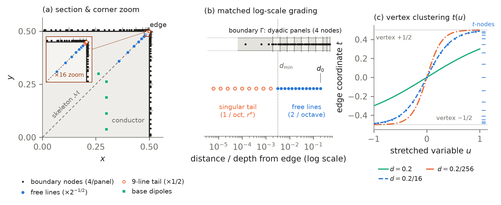

# The Method of Fundamental Solutions for Maxwell's Equations

[](https://github.com/sap6/MFS/actions/workflows/tests.yml)
[](https://colab.research.google.com/github/sap6/MFS/blob/main/notebooks/1_sphere.ipynb)
[](LICENSE)

Code and data for the paper *The Method of Fundamental Solutions for Maxwell's
Equations* by Saptarshi Bandyopadhyay and Timo Betcke (submitted to the
Journal of Computational Physics). The paper grew out of the first author's
MSci thesis, whose notebooks are kept in [`thesis/`](thesis).

The Method of Fundamental Solutions (MFS) approximates the field scattered by a
perfect conductor by a sum of dipoles placed inside the body. It needs no mesh
and no integration over the surface, and it converges rapidly, but only if the
sources are in the right place. We study where to place them on five shapes: a
sphere, a torus, a cube, a regular tetrahedron and the NASA almond:

- **Smooth and thin bodies (sphere, torus, almond away from the tip):** place dipoles so they enclose the interior singularities of the continued field (the centre of the sphere, the focal ring of the torus, and the mid-plane focal curve of the almond).
- **Convex polyhedra (cube, regular tetrahedron):** place electric and magnetic dipoles on the interior medial surface (*skeleton*, the edge-bisector walls), using polynomial line densities stretched towards the vertices rather than rows of discrete points.
- **Sharp edges and conical tips (polyhedron edges/vertices, almond tip):** continue truncated source clusters all the way to the singularity with a *singular tail* weighted by the analytical exponents of the local Maxwell field, adding only a handful of unknowns.



*Source layout on the cube at level $J = 6$ (Figure 3 of the paper): free dipole lines on the edge-bisector plane down to $d_{\min}$, followed by a nine-line singular tail with fixed power-law weights. Whereas dipoles on a scaled inner cube stall above 20% error, this layout converges root-exponentially down to $2\times10^{-5}$.*


*Error of the scattered field against computing time for the MFS and for the
boundary element library Bempp, both using the same symmetries of the body
(Figure 11 of the paper).*

## Try it in the browser

Each notebook runs in a few minutes on Colab, with no installation. Click the
badge at the top of each notebook, or below.

| Notebook | What it shows | Time |
|---|---|---|
| [1. The sphere](notebooks/1_sphere.ipynb) [](https://colab.research.google.com/github/sap6/MFS/blob/main/notebooks/1_sphere.ipynb) | five-line MFS solve against the Mie series, $\exp(-c\sqrt{N})$ convergence and $R_s$ conditioning, near-surface field | under a minute |
| [2. The torus](notebooks/2_torus.ipynb) [](https://colab.research.google.com/github/sap6/MFS/blob/main/notebooks/2_torus.ipynb) | azimuthal Fourier decoupling (axial vs oblique waves), optical theorem, focal-ring bound on the source torus | under a minute |
| [3. The cube & tetrahedron](notebooks/3_cube.ipynb) [](https://colab.research.google.com/github/sap6/MFS/blob/main/notebooks/3_cube.ipynb) | why inner copies stall, skeleton layout, edge residual with/without tails, oblique wave, and regular tetrahedron | about four minutes |
| [4. The NASA almond](notebooks/4_almond.ipynb) [](https://colab.research.google.com/github/sap6/MFS/blob/main/notebooks/4_almond.ipynb) | mid-plane focal-curve layout and tip tail, nose-on convergence, 3.5 GHz monostatic RCS against the Austin benchmark | about three minutes |

## Install

    pip install git+https://github.com/sap6/MFS

or, to run the figure scripts and the tests as well:

    git clone https://github.com/sap6/MFS && cd MFS
    pip install -e ".[test]"          # add ",bempp" for the boundary element comparison
    python -m pytest tests            # about a minute, most of it compiling the kernels

Then, for example, the sphere against the Mie series:

```python
import numpy as np
from mfs import core, mie, sphere

k = 2 * np.pi                                   # the sphere is two wavelengths across
d, p = core.wave()                              # the plane wave: along -z, polarised along y
y, alpha = sphere.solve(400, k, R=0.5)          # 400 dipoles on the sphere of radius 0.5
pts = 2.0 * core.fibonacci(400)
print(f"{core.rel(core.field(pts, y, alpha, k), mie.scattered_field(pts, k, d, p)):.1e}")   # 2.0e-09
```

Each shape has one entry point:

| Shape | Call | Returns |
|---|---|---|
| sphere | `sphere.solve(N, k, R)` | source points `y` and coefficients `alpha`; the field is `core.field(pts, y, alpha, k)` |
| torus | `torus.scatter(k, d, p, ns, nphi)` | a `Solution` with `.field(pts)` and `.far(dirs)` |
| cube | `cube.solve(J, d, p, pts)` | `(E, elapsed, info)` with unknowns, weighted residual and optical mismatch |
| tetrahedron | `tetrahedron.solve(J, d, p, pts)` | `(E, elapsed, info)` with unknowns, weighted residual and optical mismatch |
| almond | `almond.nose_on(k, n_mid, n_F, pts)`, `almond.rcs(freq)` | `((y, tail), c, E, shape)` for nose-on incidence, or monostatic RCS dictionary across azimuths |

## The figures and tables of the paper

Every figure and table has a script in [`figures/`](figures). Run on its own,
the script draws the figure in seconds from the results in [`data/`](data).
With `--run` it computes those results again and overwrites `data/`
(`git checkout -- data/` restores the paper's results); the times below are on
two cores (Intel Xeon at 2.3 GHz, 8 GB RAM). The runs that
involve Bempp need `pip install -e ".[bempp]"`.

| In the paper | Script | To compute again |
|---|---|---|
| Figure 1: the sphere | [`figures/sphere.py`](figures/sphere.py) | 20 seconds |
| Figure 2: the source torus | [`figures/torus_sources.py`](figures/torus_sources.py) | 15 seconds |
| Figures 3 and 9: source layouts | [`figures/layouts.py`](figures/layouts.py) | (a drawing) |
| Figure 4: the wedge at an edge | [`figures/wedge.py`](figures/wedge.py) | (a sketch) |
| Figure 5: the residual near an edge | [`figures/edge_residual.py`](figures/edge_residual.py) | 1 minute |
| Figure 6, Table 2: convergence on the cube | [`figures/cube_convergence.py`](figures/cube_convergence.py) | 8 minutes, Bempp 8 more |
| Figure 7, Table 5: other waves and larger cubes | [`figures/cube_cases.py`](figures/cube_cases.py) | 30 to 65 minutes per case (`--run CASE`: `k1`, `k1o`, `k2`, `k3`; `--scan CASE`: 2 hours) |
| Figure 8: the regular tetrahedron | [`figures/tetrahedron.py`](figures/tetrahedron.py) | 12 minutes |
| Figure 10, Table 3: almond radar cross-section | [`figures/almond_rcs.py`](figures/almond_rcs.py) | 12 minutes |
| Figure 11, Table 4: comparison with Bempp | [`figures/cost.py`](figures/cost.py) | 2 to 10 minutes per shape (`--run SHAPE`: `sphere`, `torus`, `almond`, `almond35`) |
| Figure 12: the field near the surface | [`figures/nearfield.py`](figures/nearfield.py) | 2 minutes |
| Graphical abstract | [`figures/graphical_abstract.py`](figures/graphical_abstract.py) | seconds (from `data/`) |
| Tables 2, 4, 5, C.1 | [`figures/tables.py`](figures/tables.py) | seconds |
| Table A.1, vertex exponents | [`figures/cone_exponents.py`](figures/cone_exponents.py) | 5 minutes |

Table 1 (the edge exponents) is derived in Section 5.2 and needs no code.

Accuracy does not depend on the machine, but times do. For a fair comparison
we ran both codes on the same idle machine across two alternating passes and
kept the smaller time of each configuration.

## What is where

| Folder | Contents |
|---|---|
| [`mfs/`](mfs) | the method, one short module per shape: `core` (dyadic Green's functions, symmetries, `CSNE`/`QR` least-squares solvers), `sphere`, `torus`, `cube` and `tetrahedron` (with the line quadrature in `lines`), `almond`; the exact solution `mie`; the exponents at the almond tip and polyhedral vertices, `cone`; and the boundary element comparison, `bem` |
| [`notebooks/`](notebooks) | the four notebooks above |
| [`figures/`](figures) | one script per figure of the paper, and the tables |
| [`data/`](data) | the results behind every figure and table, and the Austin benchmark data for the almond |
| [`tests/`](tests) | checks against exact solutions and against the stored results of the paper |
| [`paper/`](paper) | the manuscript in LaTeX |
| [`thesis/`](thesis) | the notebooks of the MSci thesis, as submitted |
| [`notes/`](notes) | our research log: what was tried, what failed, derivations, literature |

The scripts of every experiment in the research log are in the git history: run
`git checkout 9f5a721 -- validation` to restore the folder.

## Citation

If you use this code, please cite the paper (see [`CITATION.cff`](CITATION.cff);
GitHub's "Cite this repository" button gives BibTeX).
The almond data in [`data/austin_almond`](data/austin_almond) are those of the
Austin RCS Benchmark Suite (Kelley et al., IEEE Antennas and Propagation
Magazine 62(1), 2020), with their licence files.
